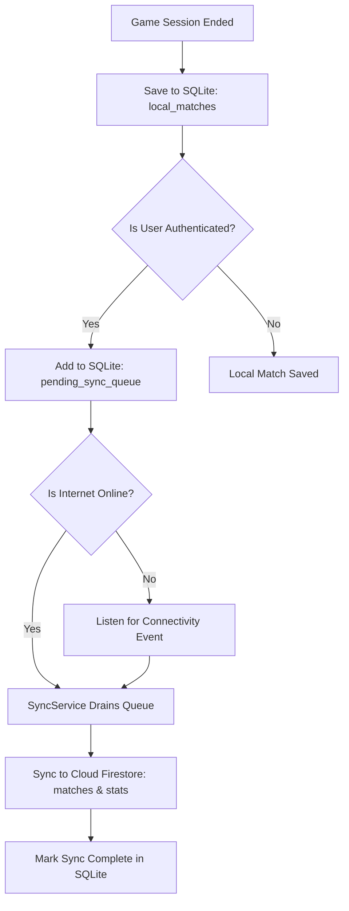

# CarromVerse Technical Architecture

This document describes the architectural foundation of **CarromVerse**, a premium mobile carrom game built for offline gameplay (Phase 1) and future real-time online multiplayer (Phase 2).

---

## 1. Monorepo Organization

The project is structured as a modular TypeScript monorepo with strict boundary separation between mobile application UI, game physics rendering, game rules, and shared types.

```
CarromVerse/
├── apps/
│   └── mobile/                # Expo Router mobile application (React Native)
│       ├── app/               # File-based routing (screens & navigation)
│       ├── src/
│       │   ├── components/    # Reusable UI primitives (StyleSheet-based)
│       │   ├── constants/     # Premium dark theme, storage keys, config
│       │   ├── services/      # Firebase, Local Storage, SQLite, Sync
│       │   └── store/         # Isolated Zustand stores
│       └── assets/            # Fonts, audio, textures, animations
│
├── packages/
│   ├── shared-types/          # Canonical contracts (Player, GameMode, Turn, etc.)
│   ├── shared-utils/          # Validation, math/vectors, UUIDs, event emitters
│   ├── game-logic/            # Pure TypeScript Carrom rules & turn state machines
│   └── game-engine/           # Phaser 3 + Matter.js simulation & bridge protocol
│
├── docs/                      # Architectural & setup guides
├── firestore.rules            # Granular Firestore security policies
├── storage.rules              # Firebase Storage ownership policies
└── .env.example               # Client environment variable schema
```

---

## 2. Technical Evaluation: Phaser 3 & Matter.js in React Native

### The Core Integration Challenge
Phaser 3 is an HTML5 2D game framework designed to run inside an environment that provides:
- The Document Object Model (`document.createElement('canvas')`)
- Window event listeners (`window.addEventListener('resize')`, touch/mouse pointer events)
- WebGL / HTML5 2D Canvas rendering context
- Web Audio API

**React Native's native views do not provide a DOM or HTMLCanvasElement.** 

### Architectural Approaches Evaluated:

| Approach | Architecture | Advantages | Disadvantages | Decision |
|---|---|---|---|---|
| **A: Native Headless + Custom Skia** | Run Matter.js on RN JS thread; render shapes using React Native Skia. | Single JS context; native Skia draw calls. | Discards Phaser entirely (no scenegraph, tweens, particles, cameras, asset loaders); high CPU overhead on RN thread. | ❌ Rejected |
| **B: WebView Bridge (Commercial Standard)** | Run full Phaser 3 + Matter.js inside a hardware-accelerated local WebView container (`react-native-webview`). | 100% Phaser 3 compatibility; 60 FPS WebGL rendering; isolates physics ticks from React rendering; identical web & mobile behavior. | Asynchronous bridge messaging via JSON `postMessage`. | ✅ **Selected** |

### The WebView Bridge Protocol
To ensure high performance and maintain decoupling:
1. **React Native UI controls state & high-level navigation:**
   - User profile, game setup, pause menus, score HUD, matchmaking, and audio settings are rendered in React Native.
2. **Game Engine handles real-time simulation:**
   - Board friction, striker impulse, coin-to-coin elastic collisions, and pocket detection run in Phaser 3 with Matter.js at 60 FPS.
3. **Structured Typed Bridge:**
   - React Native sends commands (`INIT_ENGINE`, `SET_STRIKER_POSITION`, `FIRE_STRIKER`, `PAUSE_ENGINE`) via `webViewRef.current.postMessage(JSON.stringify(cmd))`.
   - Phaser sends simulation events (`ENGINE_READY`, `COIN_POCKETED`, `STRIKER_POCKETED`, `COLLISION`, `ALL_BODIES_SETTLED`) back via `window.ReactNativeWebView.postMessage(JSON.stringify(evt))`.

---

## 3. Offline-First Architecture

Gameplay in CarromVerse is completely decoupled from cloud connectivity. A player can play all game modes indefinitely without internet access.



### Storage Layers
1. **AsyncStorage (`@react-native-async-storage/async-storage`):**
   - High-speed, lightweight key-value storage.
   - Used for audio volume, aim assist preferences, onboarding completion flag, and cached user profile.
2. **SQLite Database (`expo-sqlite`):**
   - Structured relational storage with WAL (Write-Ahead Logging) enabled.
   - `local_matches`: Preserves complete match records (mode, final scores, duration, turn count, completedAt).
   - `pending_sync_queue`: Holds matches awaiting cloud sync with retry count and backoff diagnostics.
3. **Connectivity Detection & Synchronization (`SyncService`):**
   - Monitored continuously via `@react-native-community/netinfo`.
   - Idempotent writes to Firestore: Documents are keyed by unique `match.id`, preventing duplicate match records even upon network reconnection retries.

---

## 4. Pure Game Logic Foundation

All game rules are isolated in `packages/game-logic` without React Native or DOM dependencies:
- **`CarromRulesManager`**:
  - Validates legal striker placement across the player's assigned baseline segment.
  - Implements Queen coverage logic: If a player pockets the Queen, they enter `pending_cover` status. To cover, they must pocket one of their assigned coins on their very next shot (or the same shot). Failing to cover returns the Queen to the center circle.
  - Detects fouls (striker pocketing, out-of-bounds, suicide fouls) and assesses penalty coins due.
  - Determines if the active player earns an extra turn.
- **`TurnManager`**:
  - Rotates turns according to active game mode:
    - **2-Player**: Alternates Seat 0 and Seat 2.
    - **3-Player**: Rotates 0 -> 1 -> 2.
    - **4-Player Individual**: Rotates 0 -> 1 -> 2 -> 3.
    - **4-Player Team (2 vs 2)**: Partners sit opposite (Seat 0 & 2 = Team A; Seat 1 & 3 = Team B). Turn alternates Team A -> Team B -> Team A -> Team B.
    - **Practice Mode**: Seat 0 continuous turns.
- **`ScoreManager`**:
  - Calculates score tallies and evaluates round/match victory conditions.

---

## 5. State Management Isolation (Zustand)

State is organized into dedicated, orthogonal stores:
- `useAuthStore`: User authentication state, login/logout actions, error messages.
- `useUserStore`: Player profile, rank, experience, cloud stats.
- `useSettingsStore`: Audio toggles, haptic settings, aim assist, graphics quality.
- `useGameSetupStore`: Player configurations, seat assignments, custom names.
- `useGameSessionStore`: Active game session, turn status, score tallies.

> [!IMPORTANT]
> **No per-frame physics calculations are stored in Zustand.** Rigid body coordinates and velocities remain inside the Matter.js physics engine to ensure 60 FPS render performance on low-end devices without triggering React component re-renders.

---

## 6. Security Model

1. **Client Bundles:**
   - Only `EXPO_PUBLIC_*` variables are exposed to the client bundle.
   - No Firebase Admin SDK, service accounts, or private master keys are bundled in the mobile application.
2. **Firestore Security Rules (`firestore.rules`):**
   - Users can only read public profiles and write to their own private profile record (`users/{userId}`).
   - Game statistics can only be updated by the authenticated owner (`gameStatistics/{userId}`).
   - Synced match records can only be created by the authenticated player (`matches/{matchId}`).
3. **Storage Security Rules (`storage.rules`):**
   - Profile uploads are restricted to `profiles/{userId}/profile-image`, with strict content type checking (`image/jpeg`, `image/png`, `image/webp`) and a 5MB size limit.
   - Game assets and presets are strictly read-only for clients.
